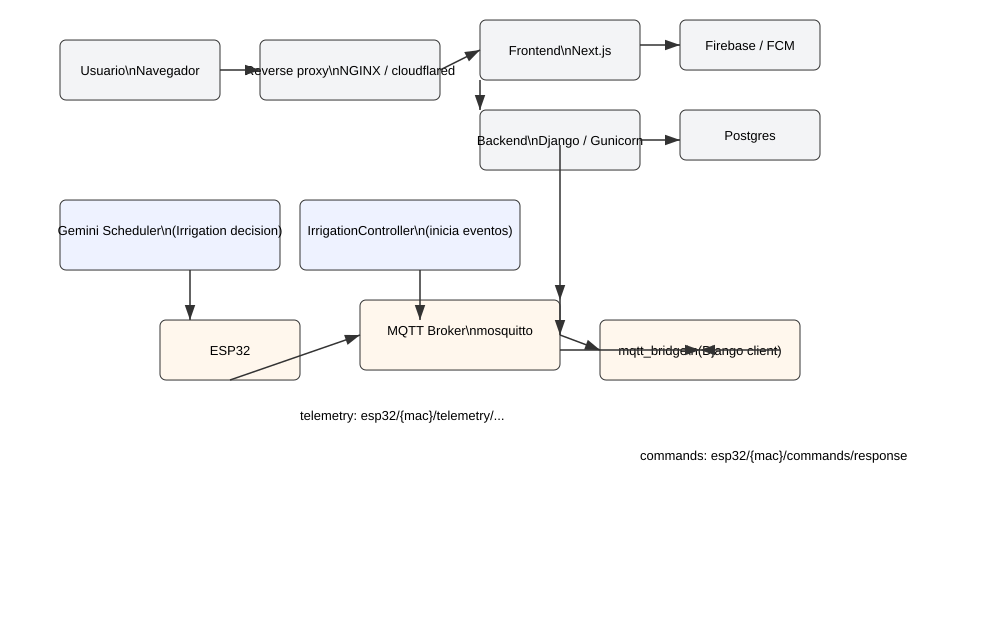

# Infraestructura y flujos de comunicación

Este documento describe, a alto nivel, cómo se conectan los distintos componentes de la pila cuando un usuario accede a la web y cómo se comunican las ESP32 con el servidor.

**Propósito**: ayudar a desarrolladores y operadores a entender los puntos de integración, tópicos MQTT y dónde mirar logs para depuración.

---

**Resumen rápido**

- Usuario (navegador) ↔️ Reverse proxy (nginx / cloudflared) ↔️ Frontend Next.js y/o backend Django (Gunicorn)
- ESP32 ↔️ MQTT Broker (mosquitto) ↔️ `mqtt_bridge` (Django management command) ↔️ Base de datos y lógica de riego
- Firebase/FCM: envío de notificaciones desde backend (archivo `firebase-adminsdk.json`) hacia dispositivos/usuarios

---

**Servicios principales (docker-compose)**

- `nginx` / reverse-proxy: maneja TLS, redirecciones y sirve/encamina peticiones hacia `frontend` y `web` (Django). Configs relevantes: [nginx-ssl.conf](nginx-ssl.conf).
- `frontend` (Next.js): aplicación PWA que sirve las páginas, service worker (`sw.js` / `sw-custom.js`) y hace polling/llamadas a la API en `/api/*` o al backend Django. Ficheros clave: [frontend-nextjs/app], `next.config.ts` (basePath), `public/manifest.json`.
- `web` (Django + Gunicorn/uwsgi): API REST (DRF) y lógica de backend. Punto de entrada: `manage.py`, `backend/wsgi.py`.
- `mosquitto` (MQTT broker): gestiona conexiones MQTT de las ESP32 y de clientes internos (p. ej. publishes puntuales desde Django).
- `mqtt-bridge` (Django management command `mqtt_bridge`): cliente MQTT de larga duración que se conecta al broker, se suscribe a tópicos de telemetría y de comandos, y escribe/lee en la base de datos.
- `certs` / `cloudflared`: soporte para túneles y credenciales de Cloudflare si se usa `cloudflared` para exponer servicios.
- `postgres` / `db` (BD relacional): almacena `SoilMoisture`, `IrrigationEvent`, `ESP32Device`, configuraciones, etc.

---

**Flujo HTTP cuando un usuario accede a la web**

1. Usuario abre el navegador y solicita `https://mi-dominio/`.
2. DNS y Cloudflare (o el proveedor) resuelven y el tráfico llega al reverse-proxy:
   - Si se usa `cloudflared`, éste puede terminar el túnel hacia la red interna; alternativamente NGINX termina TLS.
   - NGINX recibe la petición, aplica reglas (headers, redirects) y decide destino:
     - Rutas estáticas o `/_next/static` → normalmente servidas por `frontend` (Next.js) o por NGINX si se ha exportado/staticizado.
     - Rutas de la app que requieren SSR o API → pasa la petición al proceso `frontend` (Next.js) o al `web`/API según la configuración (`basePath` en Next.js puede cambiar rutas a `/app`).
3. `frontend` renderiza la página (SSR o SSG) y entrega HTML/CSS/JS. El service worker y `manifest.json` se instalan si el usuario acepta PWA.
4. La UI hace llamadas XHR/Fetch/GraphQL a la API REST en endpoints como `/api/measurements/`, `/api/irrigation/` que apuntan al backend Django (`web`).
5. Django (Gunicorn) recibe la petición, ejecuta la vista/serializador, puede acceder a la BD (Postgres) y/o publicar eventos a MQTT (o consultar servicios externos como Gemini/AEMET). Responde al frontend.
6. Resultados: datos en la UI, notificaciones push (FCM) se registran si corresponde.

Dónde mirar logs si falla: contenedores `web`, `frontend`, `nginx` y `cloudflared`.

---

**Flujo MQTT y comunicación con ESP32**

Componentes clave:
- Broker MQTT (mosquitto) — punto central de pub/sub.
- ESP32 — dispositivo de campo que se conecta al broker y publica/consume tópicos.
- `mqtt_bridge` — cliente de Django que mantiene conexión y procesa mensajes entrantes.

Tópicos principales (convención usada en el proyecto):
- Telemetría (ESP32 → servidor):
  - `esp32/{mac}/telemetry/soil`  (lecturas de humedad por zonas)
  - `esp32/{mac}/telemetry/luminosity`
  - `esp32/{mac}/telemetry/environment`
- Comandos (servidor → ESP32):
  - `esp32/{mac}/commands/response`  (payload con `commands: [...]` que la ESP32 actúa al recibir en su poll activo)
  - `esp32/{mac}/commands/request`   (ESP32 puede usar este tópico para solicitar acciones; el bridge responde o procesa)
- Notificaciones y estado:
  - `esp32/{mac}/notifications`

Flujo típico de telemetría y riego:
1. ESP32 publica telemetría periódica a `esp32/{mac}/telemetry/soil` con payload JSON (puede incluir `zones`, `esp32_ip`, `timestamp`).
2. `mqtt_bridge` (Django) está suscrito a `esp32/+/telemetry/#` y recibe el mensaje:
   - Extrae `mac`, crea/actualiza `ESP32Device` (`get_or_create_device`), guarda lecturas `SoilMoisture` (función idempotente `_save_soil_reading_once`).
   - Actualiza `last_seen` y otros metadatos.
   - Tras insertar la medición, llama a `IrrigationController().verificar_y_gestionar_riego()` desde el endpoint de mediciones o internamente para decidir si iniciar riego.
3. Si se decide iniciar riego (manual o automático), se crea un `IrrigationEvent` en la BD y el backend puede publicar inmediatamente un comando `ON` al tópico `esp32/{mac}/commands/response`: payload con `commands: [{ relay, plant_type, command:'ON', duration, event_id, ... }]`.
4. La ESP32, en su siguiente poll/consulta (o si está en `active_poll_ms`), consume el mensaje y ejecuta el relé (e.g., abre electroválvula durante `duration` segundos) y publica notificaciones de `start` / `completed` en `esp32/{mac}/notifications`.
5. `mqtt_bridge` consume esas notificaciones y actualiza el evento (`device_started_at`, `fecha_fin`, `duracion_real_segundos`, etc.).

Observaciones de robustez:
- El backend dispone de dos mecanismos para enviar comandos inmediatos:
  - Publicar puntual usando un cliente MQTT temporal (`_publish_mqtt_command`) que hace `connect()`, `loop_start()`, `publish()` y `disconnect()`.
  - `mqtt_bridge` actúa como consumidor permanente y puede publicar/coordinar comandos desde un cliente conectado de larga duración.
- El diseño intenta ser idempotente: lecturas duplicadas dentro de una ventana corta se deduplican.

---

**Decisiones y reglas de riego (dónde se aplican)**

- `IrrigationController.necesita_riego()` aplica la lógica de umbral, mínimos entre riegos y máximo diario. Si `riego_automatico_activo` está a `False`, esta función devuelve `False` (no regar).
- `necesita_riego_por_planta()` calcula la media de N últimas lecturas y delega en `necesita_riego()`.
- `verificar_y_gestionar_riego()` / `_verificar_riego_planta()` se ejecutan al insertar una medición (endpoint `Measurement.create`) y pueden iniciar riegos automáticos.
- Scheduler IA (Gemini) actualmente llama directamente a `IrrigationController.iniciar_riego()` si la IA decide `regar`, sin verificar `riego_automatico_activo`; por eso la IA puede iniciar riegos aunque el flag esté desactivado (posible ajuste recomendado).

---

**Autenticación y credenciales**

- MQTT puede requerir usuario/contraseña (configurable via `MQTT_USERNAME` / `MQTT_PASSWORD`). El broker `mosquitto` tiene archivos `mosquitto.conf` y `acl` en la carpeta `mosquitto/`.
- Credenciales y claves privadas: `firebase-adminsdk.json`, `cloudflared-credentials.json` y `certs/` deben protegerse (no incluir en repos públicos).

---

**Puntos de observabilidad y depuración**

- Logs:
  - `docker compose logs web` — ver logs Django/Gunicorn (acciones de riego, errores de publish, Gemini).
  - `docker compose logs mqtt-bridge` o `docker compose logs --tail=200 web | rg MQTT` — ver actividades MQTT.
  - `docker compose logs mosquitto` — errores de autenticación/conexiones del broker.
  - `docker compose logs frontend` — errores de SSR/compilación o 404 de assets.
- Comandos útiles:
```bash
# Desde el host con docker-compose
docker compose ps
docker compose logs --tail=200 web
docker compose exec web python manage.py shell
# En el shell Django: probar iniciar riego manualmente
from measurements.irrigation_control import IrrigationController
IrrigationController().iniciar_riego('Prueba', tipo_planta='lechuga', duracion_segundos=10, automatico=True)
```
- Para depurar MQTT desde host (si broker acepta conexiones desde host):
```bash
mosquitto_sub -h <MQTT_HOST> -p <MQTT_PORT> -t 'esp32/+/commands/response' -u <user> -P <pass>
```

---

**Recomendaciones rápidas**

- Alinear scheduler IA con la misma política `riego_automatico_activo`/`modo_riego` (si se desea control centralizado): modificar `measurements/apps.py` para consultar `IrrigationConfig` antes de ejecutar `iniciar_riego()`.
- Mantener `mqtt_bridge` como el principal responsable de procesar telemetría y confirmar comandos — esto facilita reconciliación y evita races.
- Proteger credenciales y revisar `mosquitto/acl` si se presentan `Connection Refused: not authorised` desde `mosquitto_sub`.

---

Si quieres, puedo:
- Generar un diagrama simple (Mermaid) de los flujos.
- Aplicar el parche para que Gemini respete `riego_automatico_activo`/`modo_riego`.
- Crear una checklist de pruebas end‑to‑end (telemetría → decisión → publish → ESP32 execution → DB update).

---

Documento generado automáticamente desde el repositorio local.

---

**Diagrama (visual)**



**Diagrama (Mermaid)**

```mermaid
flowchart LR
  subgraph WebLayer [Capa Web]
    B(Usuario\nNavegador)
    N(Reverse proxy\nNGINX / cloudflared)
    F(Frontend\nNext.js PWA)
    W(Backend\nDjango / Gunicorn)
    DB(Postgres)
    FB(Firebase / FCM)
  end

  subgraph IoT [Capa IoT / MQTT]
    ESP(ESP32)
    MB(MQTT Broker\nmosquitto)
    BR(mqtt_bridge\n(Django client))
  end

  B -->|HTTPS| N
  N --> F
  N --> W
  F -->|API REST / GraphQL| W
  W -->|SQL| DB
  W -->|FCM pushes| FB

  ESP -->|telemetry: esp32/{mac}/telemetry/...| MB
  MB -->|suscribe| BR
  BR -->|persist/logic| DB
  BR -->|notify backend| W
  W -->|publish commands| MB
  MB -->|commands/response ->| ESP

  subgraph IA[Decisión IA]
    GEM(Gemini Scheduler)
    IC(IrrigationController)
  end

  GEM -->|decisión (regar?)| IC
  IC --> W
  IC -->|crea evento & publica| MB

  style WebLayer fill:#f3f4f6,stroke:#333,stroke-width:1px
  style IoT fill:#fff7ed,stroke:#333,stroke-width:1px
  style IA fill:#eef2ff,stroke:#333,stroke-width:1px
```
